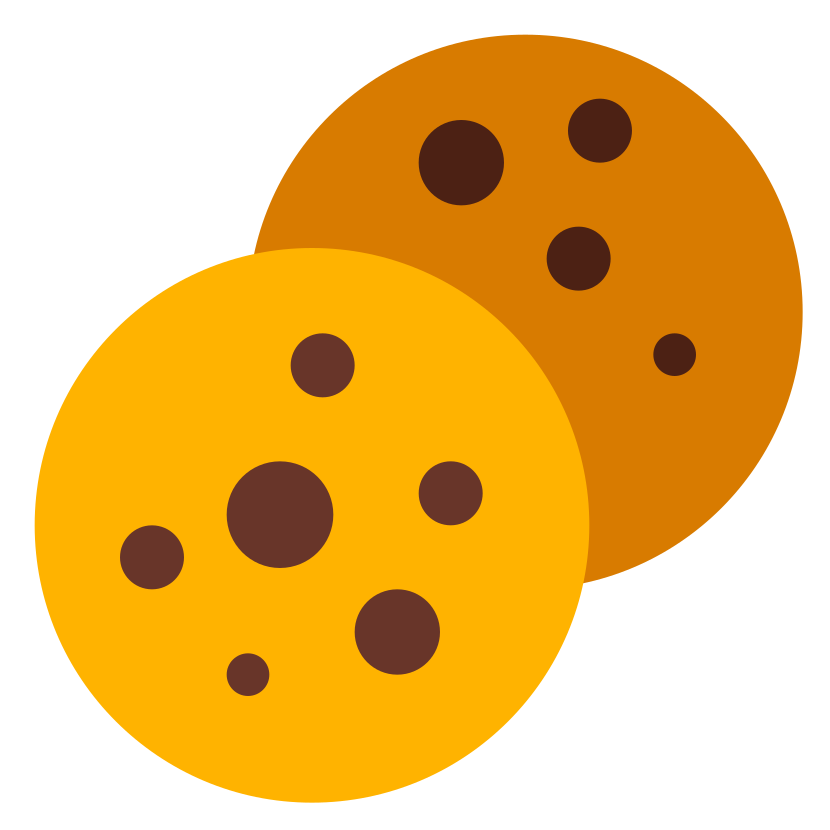

# Cookie Quick Copy

<p align="center">
  
</p>

<p align="center">
  <a href="./LICENSE">
    
  </a>
  <a href="https://v3.vuejs.org/">
    
  </a>
  <a href="https://www.typescriptlang.org/">
    
  </a>
</p>

[English](./README_EN.md) | 简体中文

## 📝 简介

一款快捷同步网站cookie至目标网站的谷歌插件，基于Vue 3.0 + TypeScript + Ant Design Vue开发。

## ✨ 特性

- ✅ 支持cookie全量复制至目标网站
- ✅ 支持自动同步功能
- ✅ 支持中英双语（自动跟随浏览器语言）
- ✅ 简洁直观的操作界面

## 🚀 安装

### 从Chrome商店安装

1. 访问Chrome网上应用店
2. 搜索"Cookie Quick Copy"
3. 点击"添加至Chrome"

### 手动安装

1. 下载最新版本的zip文件
2. 解压下载的文件
3. 打开Chrome扩展页面 (chrome://extensions/)
4. 启用开发者模式
5. 点击"加载已解压的扩展程序"并选择解压目录

## 🔨 开发

### 目录结构

```
├── dist
│   ├── cookie-quick-copy        // 已解压的插件
│   ├── cookie-quick-copy.crx    // 打包后的crx文件
│   ├── cookie-quick-copy.zip    // 打包后的zip文件
├── src
│   ├── assets                   // 静态资源
│   ├── extension                // 插件配置文件
│   ├── hooks                    // 公共方法库
│   ├── locales                  // 国际化文件
│   ├── modules                  // 核心模块
│   │   ├── popup                // 弹出窗口
│   │   └── background           // 后台脚本
│   ├── types                    // 类型声明文件
│   ├── utils                    // 工具函数
│   └── config.ts                // 配置文件
```

### 环境要求

- Node.js >= 14
- Yarn >= 1.22

### 安装依赖

```bash
yarn install
```

### 开发调试

```bash
# 样式调试模式
yarn serve

# 插件调试模式
yarn watch
```

### 构建

```bash
# 构建解压版本
yarn build

# 构建zip包
yarn build:zip

# 构建crx文件
yarn build:crx

# 构建所有文件
yarn build:all
```

## 📖 使用文档

- [Chrome扩展开发文档](https://developer.chrome.com/docs/extensions/reference/)

## 🤝 贡献

欢迎提交问题和改进建议！

## 📄 开源协议

本项目基于 [AGPL-3.0](./LICENSE) 协议开源。

## 🙏 致谢

- 图标设计: [Crazy、晓鸢](https://www.iconfont.cn/user/detail?uid=56212)
